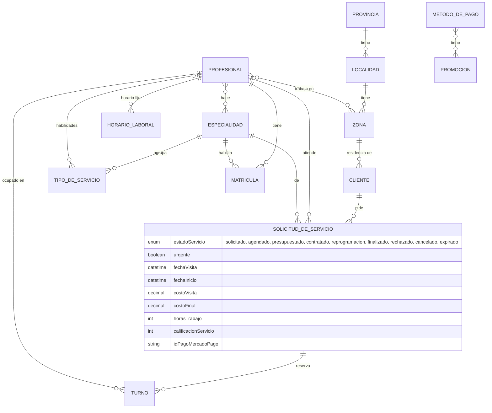

# Propuesta TP DSW — Manitas (actualizada)

## Grupo

### Integrantes

* 56821 - Arias, Francisco José
* 52098 - Monzón, Maximiliano Nicolás
* 54456 - Baremboum, Micaela
* 42062 - Coria, Lautaro

### Repositorios

* [fullstack app (monorepo)](https://github.com/MaxiNMonzon/Manitas): `manitas-backend` (API) y `manitas-frontend` (SPA)

*Pull requests de entrega:* back → _(completar link)_ · front → _(completar link)_

## Tema

### Descripción

Aplicación que conecta clientes con profesionales de oficios para resolver tareas del hogar. El cliente busca un
profesional por oficio y zona, le pide presupuesto eligiendo un turno libre para la visita (o pide una urgencia que le
llega a todos los profesionales cercanos), acepta el presupuesto, paga por Mercado Pago y califica. Cada profesional
define sus tarifas, su horario y sus zonas. Se informan las promociones bancarias del mes según el método de pago.

### Modelo

Además: `CONSULTA` (consultas de la sección Ayuda, las lee el administrador). Diagrama original:
[modelo de dominio](https://drive.google.com/file/d/1yA9dty0EUn0jITPk4veSDCFWdFEMilrt/view).

## Alcance Funcional

### Alcance Mínimo

Regularidad:

| Req | Detalle | Dónde está |
| :- | :- | :- |
| CRUD simple | 1. CRUD Usuario (cliente y profesional) 2. CRUD Tipo de Servicio 3. CRUD Localidad 4. CRUD Método de Pago | 1. Registro + Mi perfil (ver, editar, dar de baja) y listado del admin 2–4. Panel de administración → Catálogos |
| CRUD dependiente | 1. CRUD Zona {depende de} CRUD Localidad 2. CRUD Profesional {depende de} CRUD Especialidad | 1. Panel de administración → Zonas 2. Registro / Mi perfil del profesional (elige especialidades, habilidades y zonas) |
| Listado + detalle | 1. Tipos de servicio filtrados por especialidad → detalle del tipo de servicio y su especialidad 2. Profesionales filtrados por especialidad (y zona) → detalle del perfil con especialidades, zonas, costo de visita y reseñas | 1. Admin → Tipos de servicio 2. Cliente → Profesionales |
| CUU/Epic | 1. Solicitar servicio (pedir presupuesto con turno) 2. Calificar servicio | Cliente → Profesionales / Mis solicitudes |

Adicionales para Aprobación:

| Req | Detalle | Dónde está |
| :- | :- | :- |
| CRUD | CRUD de todas las clases de negocio necesarias: Usuario (Cliente, Profesional), Especialidad, Tipo de Servicio, Provincia, Localidad, Zona, Método de Pago, Promoción, Horario laboral | Admin → Catálogos (Especialidad, Tipo de servicio, Provincia, Localidad, Zona, Método de pago, Promoción; Clientes y Profesionales en consulta); Profesional → Agenda → Mi horario; Usuario desde Mi perfil |
| CUU/Epic | 1. Solicitar presupuesto / servicio (también urgente) 2. Coordinar visita (turnos libres, aceptar y reprogramar) 3. Confirmar servicio (presupuesto + aceptación con reserva de horas) 4. Abonar servicio (Mercado Pago) 5. Calificar profesional 6. Informar promociones bancarias del mes 7. Notificar próximas visitas (avisos) | Encadenados: la solicitud (1) genera la visita (2), que habilita el presupuesto (3), que habilita el pago (4), que habilita la calificación (5), que alimenta el perfil del profesional que ve el próximo cliente (1) |

### Alcance Adicional Voluntario

| Req | Detalle |
| :- | :- |
| Listados | 1. Mis solicitudes del cliente por estado (en curso / completadas) con detalle 2. Solicitudes del profesional por estado (nuevas / en curso / historial) agrupadas en carpetas 3. Agenda mensual del profesional 4. Cobros del profesional (pendientes y depositados) |
| CUU/Epic | 1. Servicio urgente: le llega a todos los profesionales de la zona y el primero que acepta indica cuándo llega 2. Reprogramación de visita o trabajo con contrapropuestas 3. Consultas de Ayuda al administrador |
| Otros | 1. Pago con Mercado Pago Checkout Pro (sandbox) con verificación del pago en el servidor 2. Avisos dentro de la app (polling) 3. Vencimiento automático de solicitudes sin respuesta 4. Datos de prueba (`seed:demo`) y catálogo geográfico real (`seed:georef`, API Georef) 5. Documentación OpenAPI/Swagger |
